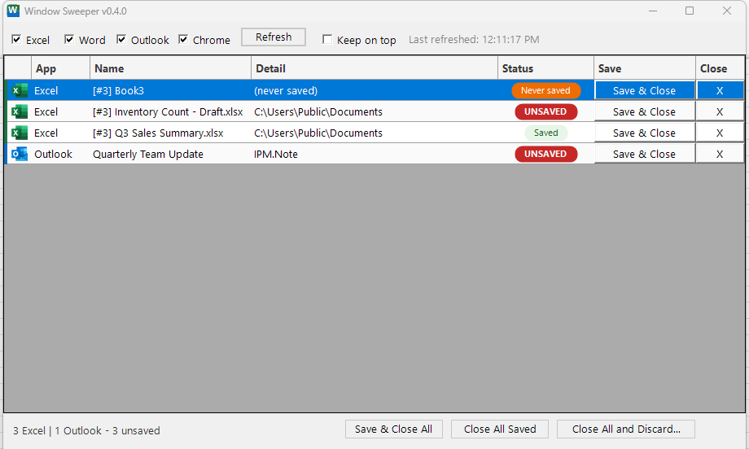

# Window Sweeper

Window Sweeper lists every open Excel workbook, Word document, classic
Outlook message/folder window, and (optionally) Chrome tab or browser
window in one place, so you can save-and-close or just close each one
without clicking through them one at a time and answering "Do you want to
save changes?" for every single window. Actions are quick - usually 1-3
seconds each - and nothing closes without a live re-check of its actual
save state first.

## Features

- **One list, four apps.** Excel, Word, classic Outlook, and Chrome, each
  with its own icon and accent color so the grid reads at a glance.
- **Live unsaved-state safety re-check.** A row's status can go stale
  between refreshes - before any close discards anything, the tool
  re-reads the real save state at that exact moment. If that read itself
  fails for any reason, it is always treated as *unsaved*, never silently
  assumed safe.
- **Single-click or batch.** Save & Close / X on one row, or Save & Close
  All / Close All Saved / Close All and Discard for many at once. The
  discard batch always lists every file/email/tab it is about to touch
  before you confirm.
- **Never launches anything.** Every app is attached to only if it is
  already running - Window Sweeper never starts Excel, Word, Outlook, or
  Chrome as a side effect of listing or refreshing.
- **Chrome tabs are opt-in.** Off by default, Chrome shows up as whole
  browser windows. Point it at a Chrome debug port (see below) to get
  individual tabs instead.
- **Action log.** Every save/close/discard is recorded to a local CSV, one
  row per action.
- **100% local.** No installer, no telemetry, no account.

## Screenshots



## Requirements

- Windows 10 or 11.
- Windows PowerShell 5.1 (included with Windows; this is not PowerShell 7 /
  `pwsh`).
- Desktop Excel and/or desktop Word, for those rows to appear.
- **Classic** desktop Outlook, for Outlook rows to appear. The new Outlook
  (the UWP/web-based rewrite) does not support the automation this tool
  relies on - if it's the only Outlook installed, Window Sweeper will tell
  you so instead of silently showing nothing.
- Chrome is optional and off by default (see **Chrome tabs** below).

## Install

1. Download the release zip and extract it anywhere.
2. Windows will likely flag the downloaded zip via SmartScreen or the
   Attachment Manager, since it came from the internet. Right-click the
   zip -> **Properties** -> check **Unblock** -> **OK**, *then* extract it.
   (If you extract first and still see a warning when you run the tool,
   go back and unblock the zip, delete the extracted copy, and extract
   again.)
3. Double-click `Run-WindowSweeper.bat`.

No execution-policy step is needed - the launcher already starts
PowerShell with `-ExecutionPolicy Bypass` for its own child process only;
it does not change any policy on your machine.

## Chrome tabs

Out of the box, Chrome shows up as whole browser **windows** only (closing
one may show Chrome's own "close all tabs?" prompt - that's Chrome asking,
not this tool). To list and close **individual tabs**, start Chrome with
remote debugging on and tell Window Sweeper the port:

1. Start Chrome like this. Chrome 136 and newer requires **both** switches
   together; use any folder you like for the second one:
   ```
   chrome.exe --remote-debugging-port=9333 --user-data-dir=C:\ChromeDebugProfile
   ```
2. Open `%USERPROFILE%\.window-sweeper\settings.json` in Notepad and add:
   ```json
   "chromeDebugPorts": [9333]
   ```
3. Restart Window Sweeper. Tabs from that Chrome now appear as rows.

**Warning:** only point this at a Chrome you are happy to have tabs closed
in. If a debug port belongs to an automation setup - a browser some other
tool drives - adding it here lets Window Sweeper close that automation's
tabs too.

## Privacy

Window Sweeper is 100% local. There is no telemetry and no network calls
of any kind, except to the loopback (`127.0.0.1`) Chrome debug port(s) you
explicitly configure yourself. Logs stay on your machine, under
`%USERPROFILE%\.window-sweeper\logs\`.

## Troubleshooting

- **Orange "busy" banner?** Click **Show the dialog** - it brings whatever
  dialog is blocking that app to the front. Handle it, then click
  **Refresh**.
- **Need a detailed trace for a bug report?** Close the tool, set the
  environment variable `WINDOWSWEEPER_DEBUG=1`, and reopen it. A trace log
  is written to `%USERPROFILE%\.window-sweeper\logs\debug.log`.

## How it works

See [`docs/ARCHI.md`](docs/ARCHI.md) for the architecture: the worker-
runspace/watchdog model, the action-routing table, and the per-app
adapters.

## License

[MIT](LICENSE)

